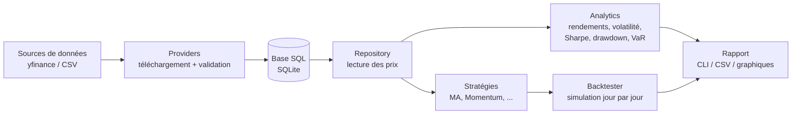

# finance-engine
 
Mini-bibliothèque Python d'**analyse de portefeuille** et de **backtesting** de stratégies d'investissement.
 
Elle récupère des prix de marché, les stocke dans une base SQL, calcule des indicateurs de performance et de risque, puis rejoue des stratégies sur l'historique pour les comparer à un benchmark.
 
> ⚠️ **Projet pédagogique.** Il ne constitue pas un conseil en investissement. Une performance passée ne garantit pas les performances futures.
 
---
 
## Sommaire
 
1. [Objectifs](#1-objectifs)
2. [Aperçu du fonctionnement](#2-aperçu-du-fonctionnement)
3. [Fonctionnalités](#3-fonctionnalités)
4. [Structure du projet](#4-structure-du-projet)
5. [Installation](#5-installation)
6. [Utilisation](#6-utilisation)
7. [Gestion des exceptions](#7-gestion-des-exceptions)
8. [Journalisation (logs)](#8-journalisation-logs)
9. [Tests](#9-tests)
10. [Glossaire financier](#10-glossaire-financier)
11. [Limites et biais à connaître](#11-limites-et-biais-à-connaître)
---
 
## 1. Objectifs
 
- Mettre en pratique du Python « propre » : classes, héritage, décorateurs, exceptions, typage, tests.
- Manipuler des données financières réelles avec SQL (dont les *window functions*) et pandas.
- Fournir un outil réutilisable, installable (`pip install -e .`) et utilisable en ligne de commande.
- Respecter les bonnes pratiques attendues en finance quantitative : absence de *look-ahead bias*, prise en compte des coûts, comparaison à un benchmark.
---
 
## 2. Aperçu du fonctionnement
 
### Schéma général
 

 
### Version texte
 
```
 SOURCES            INGESTION           STOCKAGE          TRAITEMENT              SORTIE
┌──────────┐      ┌───────────┐      ┌──────────┐      ┌───────────────┐      ┌─────────────┐
│ yfinance │ ───▶ │ Providers │ ───▶ │ SQLite   │ ───▶ │ Analytics     │ ───▶ │ Rapport CLI │
│ CSV      │      │ (+retry)  │      │ (prices) │      │ Stratégies    │      │ CSV         │
└──────────┘      └───────────┘      └──────────┘      │ Backtester    │      │ Graphiques  │
                                                       └───────────────┘      └─────────────┘
```
 
### Principe d'un backtest, jour après jour
 
```
Pour chaque jour t de l'historique :
  1. La stratégie regarde les prix jusqu'à t-1 
  2. Elle émet un signal : acheter / vendre / ne rien faire
  3. Le backtester exécute l'ordre en appliquant les coûts de transaction
  4. La valeur du portefeuille est enregistrée → courbe de capital
Fin : calcul des métriques et comparaison au benchmark
```
 
---
 
## 3. Fonctionnalités
 
| Module | Ce qu'il fait |
|---|---|
| **Ingestion** | Télécharge les prix historiques de plusieurs actifs, les valide, les stocke en SQL de façon idempotente (relancer l'import ne crée pas de doublons). |
| **Analyse** | Rendements, volatilité, ratio de Sharpe, drawdown maximum, VaR historique, matrice de corrélation. |
| **Stratégies** | Croisement de moyennes mobiles, momentum, rééquilibrage périodique. Facile d'en ajouter via la classe abstraite `Strategy`. |
| **Backtesting** | Simulation avec coûts de transaction, courbe de capital, comparaison à un benchmark. |
| **Rapport** | Résumé dans le terminal, export CSV, graphiques. |
| **CLI** | Commandes `fetch`, `backtest`, `report`, avec option `--verbose`. |
| **Logs** | Journalisation structurée (console + fichier avec rotation) de toutes les opérations importantes. |
 
---
 
## 4. Structure du projet
 
```
finance-engine/
├── pyproject.toml              # métadonnées, dépendances, config des outils
├── README.md
├── config.toml                 # tickers, dates, niveau de logs, paramètres par défaut
├── sql/
│   ├── schema.sql              # création des tables
│   └── queries.sql             # requêtes analytiques (window functions)
├── logs/                       # fichiers de logs (non versionnés)
├── src/finance_engine/
│   ├── __init__.py             # version du package
│   ├── exceptions.py           # hiérarchie d'exceptions personnalisées
│   ├── logging_config.py       # configuration centralisée des logs
│   ├── data/
│   │   ├── providers.py        # récupération des prix (API / CSV)
│   │   └── repository.py       # accès SQL (lecture / écriture)
│   ├── models/
│   │   ├── asset.py            # classe Asset
│   │   └── portfolio.py        # classe Portfolio
│   ├── analytics/
│   │   ├── returns.py          # rendements
│   │   └── risk.py             # volatilité, Sharpe, drawdown, VaR
│   ├── strategies/
│   │   ├── base.py             # classe abstraite Strategy
│   │   ├── moving_average.py
│   │   └── momentum.py
│   ├── backtest/
│   │   └── engine.py           # moteur de simulation
│   ├── utils/
│   │   └── decorators.py       # @timer, @retry, @cache, @log_call
│   └── cli.py                  # point d'entrée en ligne de commande
└── tests/
    ├── unit/                   # tests isolés (métriques, stratégies)
    └── integration/            # pipeline complet sur SQLite en mémoire
```
 
**Principe d'architecture** : trois couches séparées.
- **Données** (`data/`) : d'où viennent les prix et où ils sont stockés.
- **Logique métier** (`models/`, `analytics/`, `strategies/`, `backtest/`) : les calculs, sans dépendre de la source des données.
- **Présentation** (`cli.py`) : l'interaction avec l'utilisateur.
Grâce à cette séparation, on peut changer de source (yfinance → autre API) ou de base (SQLite → PostgreSQL) sans toucher aux calculs.
 
---
 
## 5. Installation
 
Prérequis : Python 3.10 ou supérieur.
 
```bash
# 1. Se placer à la racine du projet (là où se trouve pyproject.toml)
cd finance-engine
 
# 2. Créer et activer un environnement virtuel
python -m venv .venv
source .venv/bin/activate        # Linux / macOS
.venv\Scripts\activate           # Windows
 
# 3. Installer en mode éditable, avec les outils de développement
pip install -e ".[dev]"
```
 
Vérification :
 
```bash
python -c "import finance_engine; print(finance_engine.__version__)"
finance-engine --help
```
 
---
 
## 6. Utilisation
 
### En ligne de commande
 
```bash
# Télécharger et stocker les prix
finance-engine fetch AAPL MSFT SPY --start 2015-01-01
 
# Lancer un backtest (croisement de moyennes mobiles 50/200 jours)
finance-engine backtest --ticker AAPL --strategy moving_average --short 50 --long 200
 
# Générer un rapport de risque
finance-engine report --ticker AAPL
```
 
### En Python
 
```python
from finance_engine.data.providers import YahooProvider
from finance_engine.data.repository import PriceRepository
from finance_engine.strategies.moving_average import MovingAverageStrategy
from finance_engine.backtest.engine import Backtester
 
repo = PriceRepository("market.db")
repo.save(YahooProvider().fetch("AAPL", start="2015-01-01"))
 
strategy = MovingAverageStrategy(short_window=50, long_window=200)
result = Backtester(repo, strategy, initial_capital=10_000, fee_rate=0.001).run("AAPL")
 
print(result.summary())   # rendement, Sharpe, drawdown, nombre de trades...
```
 
*(Les noms ci-dessus décrivent l'API cible du projet ; ils seront construits étape par étape.)*
 
---
 
## 7. Gestion des exceptions
 
Le projet définit sa propre hiérarchie dans `exceptions.py` :
 
```
FinanceEngineError
├── DataProviderError          # réseau / API en échec
│   └── InvalidTickerError     # ticker inconnu ou sans données
├── RepositoryError            # erreur de base de données
├── InsufficientDataError      # pas assez de données pour un calcul
└── InvalidStrategyError       # paramètres de stratégie incohérents
```
 
Règles appliquées :
- Les erreurs techniques sont **traduites** en erreurs métier avec `raise ... from exc` (la cause d'origine est conservée).
- `@retry` ne relance que sur `DataProviderError`, jamais sur `InvalidTickerError`.
- Les exceptions sont **attrapées dans la CLI**, qui affiche un message clair et un code de sortie non nul.
- Aucun `except:` nu, aucune erreur avalée silencieusement.
---
 
## 8. Journalisation (logs)
 
Le projet utilise le module standard `logging` de Python plutôt que des `print`. Un log est un **message horodaté, classé par niveau de gravité**, que l'on peut filtrer, rediriger vers un fichier et analyser après coup. C'est indispensable pour comprendre ce qui s'est passé lors d'un import de données ou d'un backtest sans avoir à relancer le programme.
 
### Niveaux utilisés
 
| Niveau | Quand l'utiliser | Exemple dans le projet |
|---|---|---|
| `DEBUG` | Détails utiles au développement | `Requête SQL exécutée : SELECT ... (12 ms)` |
| `INFO` | Déroulement normal | `142 prix insérés pour AAPL` |
| `WARNING` | Situation anormale mais non bloquante | `3 valeurs manquantes ignorées pour MSFT` |
| `ERROR` | Une opération a échoué | `Téléchargement de TSLA impossible après 3 tentatives` |
| `CRITICAL` | Le programme ne peut pas continuer | `Base de données inaccessible` |
 
Par défaut, le niveau est `INFO`. L'option `--verbose` de la CLI passe en `DEBUG`.
 
### Configuration centralisée
 
La configuration est faite **une seule fois**, dans `logging_config.py`, appelée au démarrage par la CLI. Les autres modules n'ont qu'à récupérer leur logger :
 
```python
# src/finance_engine/logging_config.py
import logging
from logging.handlers import RotatingFileHandler
 
def setup_logging(level: str = "INFO", log_file: str = "logs/finance_engine.log") -> None:
    formatter = logging.Formatter(
        "%(asctime)s | %(levelname)-8s | %(name)s | %(message)s"
    )
 
    console = logging.StreamHandler()
    console.setFormatter(formatter)
 
    file_handler = RotatingFileHandler(
        log_file, maxBytes=1_000_000, backupCount=3, encoding="utf-8"
    )
    file_handler.setFormatter(formatter)
 
    root = logging.getLogger("finance_engine")
    root.setLevel(level)
    root.addHandler(console)
    root.addHandler(file_handler)
```
 
```python
# Dans n'importe quel module
import logging
 
logger = logging.getLogger(__name__)   # ex. "finance_engine.data.providers"
 
def fetch(ticker: str) -> None:
    logger.info("Téléchargement de %s", ticker)
```
 
Points importants :
- `logging.getLogger(__name__)` crée un logger **par module**, ce qui permet de savoir d'où vient chaque message.
- On écrit `logger.info("... %s", ticker)` et non une f-string : le formatage n'est effectué que si le message est réellement émis.
- `RotatingFileHandler` limite la taille du fichier de log (ici 1 Mo, avec 3 archives conservées).
- Le dossier `logs/` est listé dans `.gitignore` : les logs ne sont pas versionnés.
### Exemple de sortie
 
```
2025-01-15 09:42:07 | INFO     | finance_engine.data.providers  | Téléchargement de AAPL
2025-01-15 09:42:08 | INFO     | finance_engine.data.repository | 1258 prix insérés pour AAPL
2025-01-15 09:42:08 | WARNING  | finance_engine.data.providers  | 2 valeurs manquantes ignorées pour MSFT
2025-01-15 09:42:11 | ERROR    | finance_engine.data.providers  | Échec du téléchargement de TSLA (tentative 3/3)
```
 
### Lien avec les décorateurs et les exceptions
 
- **`@log_call`** journalise automatiquement l'appel d'une fonction (nom, arguments, durée) au niveau `DEBUG`.
- **`@timer`** journalise le temps d'exécution au niveau `INFO`.
- **`@retry`** émet un `WARNING` à chaque tentative échouée, puis un `ERROR` si toutes échouent.
- Lorsqu'on traduit une exception, on peut conserver la trace complète dans les logs avec `logger.exception(...)` (à utiliser dans un bloc `except`) :
```python
try:
    df = yf.download(ticker, start=start, end=end)
except Exception as exc:
    logger.exception("Échec du téléchargement de %s", ticker)
    raise DataProviderError(f"Échec du téléchargement de {ticker}") from exc
```
 
### Bonnes pratiques appliquées
 
- **Ne jamais logger de données sensibles** (clés d'API, mots de passe).
- **Ne pas dupliquer** : une erreur est journalisée à l'endroit où elle est gérée, pas à chaque couche qu'elle traverse.
- **Un message utile** : il doit dire quoi, sur quoi, et avec quel résultat (`1258 prix insérés pour AAPL` plutôt que `Terminé`).
- **Pas de `print`** dans le code de la bibliothèque : seule la CLI affiche des résultats à l'utilisateur.
### Configuration depuis `config.toml`
 
```toml
[logging]
level = "INFO"
file = "logs/finance_engine.log"
```
 
### Tester les logs
 
Avec `pytest`, la fixture `caplog` capture les messages émis :
 
```python
import logging
 
def test_missing_values_emit_warning(caplog):
    with caplog.at_level(logging.WARNING):
        clean_prices(df_with_nan)
    assert "valeurs manquantes" in caplog.text
```
 
 
---
 
## 9. Tests
 
```bash
pytest                         # tous les tests
pytest tests/unit              # tests unitaires uniquement
pytest tests/integration       # tests d'intégration
pytest --cov=finance_engine    # avec couverture de code
```
 
| Type | Cible | Techniques |
|---|---|---|
| **Unitaires** | Chaque métrique et chaque stratégie, isolément | Valeurs calculées à la main, `parametrize`, fixtures, `pytest.raises`, cas limites (série vide, un seul prix, NaN) |
| **Intégration** | Pipeline complet : ingestion → SQL → analyse → backtest | Base SQLite en mémoire (`:memory:`), API simulée avec `unittest.mock` |
 
---
 
## 10. Glossaire financier
 
### Les bases
 
| Terme | Signification |
|---|---|
| **Actif** | Tout instrument financier que l'on peut détenir : action, obligation, ETF, matière première... |
| **Action** | Part du capital d'une entreprise. Son prix évolue selon l'offre et la demande. |
| **ETF** | *Exchange-Traded Fund* : fonds coté en bourse qui réplique un indice (par exemple le S&P 500). |
| **Ticker** | Code court identifiant un actif en bourse (`AAPL` = Apple, `SPY` = ETF sur le S&P 500). |
| **Portefeuille** | Ensemble des actifs détenus, avec leurs quantités ou pondérations. |
| **Pondération** | Part de chaque actif dans la valeur totale du portefeuille (par exemple 60 % actions, 40 % obligations). |
| **Indice** | Panier d'actifs servant de mesure du marché (S&P 500, CAC 40...). |
| **Prix de clôture (*close*)** | Dernier prix de la séance. |
| **Prix ajusté** | Prix de clôture corrigé des dividendes et des divisions d'actions (*splits*), indispensable pour comparer des rendements sur longue période. |
| **Dividende** | Part des bénéfices versée aux actionnaires. |
| **Liquidité** | Facilité à acheter ou vendre un actif rapidement sans bouger son prix. |
 
### Performance
 
| Terme | Signification / formule |
|---|---|
| **Rendement (*return*)** | Variation relative du prix : `(prix_t / prix_t-1) - 1`. Si une action passe de 100 à 102, le rendement est de +2 %. |
| **Rendement cumulé** | Gain total sur la période : `(valeur_finale / valeur_initiale) - 1`. |
| **CAGR** | *Compound Annual Growth Rate*, rendement annuel moyen « lissé » : `(valeur_finale / valeur_initiale)^(1/années) - 1`. |
| **Courbe de capital (*equity curve*)** | Évolution de la valeur du portefeuille dans le temps. |
| **Benchmark** | Référence de comparaison (souvent un indice). Une stratégie n'est intéressante que si elle fait mieux que le benchmark, à risque comparable. |
| **Buy and hold** | Acheter et conserver sans rien faire. C'est le benchmark de base d'une stratégie active. |
 
### Risque
 
| Terme | Signification / formule |
|---|---|
| **Volatilité** | Écart-type des rendements : mesure l'ampleur des variations. Annualisée : `écart-type_journalier × √252` (252 jours de bourse par an). Plus elle est haute, plus l'actif est « nerveux ». |
| **Ratio de Sharpe** | Rendement obtenu **par unité de risque** : `(rendement_annuel - taux_sans_risque) / volatilité_annuelle`. En règle générale, > 1 est considéré comme bon, < 0,5 comme faible. |
| **Taux sans risque** | Rendement d'un placement considéré sans risque (bons du Trésor). Sert de point de comparaison. |
| **Drawdown** | Baisse depuis le dernier sommet : `(valeur - plus_haut_historique) / plus_haut_historique`. |
| **Drawdown maximum (*max drawdown*)** | Pire baisse sommet → creux observée sur la période. Par exemple -35 % signifie qu'on a, à un moment, perdu 35 % depuis un pic. Mesure très parlante de la « douleur » subie. |
| **VaR (*Value at Risk*)** | Perte qu'on ne devrait pas dépasser avec un niveau de confiance donné. Une VaR à 95 % de -2 % sur 1 jour signifie : dans 95 % des jours, la perte est inférieure à 2 %. |
| **VaR historique** | VaR calculée directement à partir des rendements passés (percentile des pertes), sans hypothèse de loi statistique. |
| **Corrélation** | Mesure (de -1 à +1) de la tendance de deux actifs à évoluer ensemble. Proche de +1 : ils bougent pareil. Proche de 0 : indépendants. Négative : ils bougent en sens opposé. |
| **Diversification** | Répartir son capital sur des actifs peu corrélés pour réduire le risque global. |
 
### Stratégies
 
| Terme | Signification |
|---|---|
| **Stratégie** | Ensemble de règles qui décident quand acheter ou vendre. |
| **Signal** | Décision émise par la stratégie : acheter, vendre ou conserver. |
| **Moyenne mobile (*moving average*)** | Moyenne des N derniers prix, recalculée chaque jour. Elle lisse le bruit et révèle la tendance. |
| **Croisement de moyennes mobiles** | Achat quand la moyenne courte (par exemple 50 jours) passe au-dessus de la moyenne longue (200 jours) : signe d'une tendance haussière. Vente dans le cas inverse. |
| **Momentum** | Principe selon lequel les actifs qui ont récemment monté ont tendance à continuer à monter (et inversement) à court ou moyen terme. |
| **Rééquilibrage (*rebalancing*)** | Remettre périodiquement les pondérations à leur cible. Si les actions montent et dépassent 60 % du portefeuille, on en vend pour revenir à 60 %. |
| **Position longue / courte** | Longue : on achète en espérant une hausse. Courte (*short*) : on parie sur une baisse. |
 
### Exécution et coûts
 
| Terme | Signification |
|---|---|
| **Coûts de transaction** | Frais payés à chaque achat ou vente (commissions, taxes). Ils réduisent la performance, surtout pour les stratégies qui tradent souvent. |
| **Slippage** | Écart entre le prix attendu et le prix réellement obtenu à l'exécution. |
| **Turnover (rotation)** | Volume échangé par rapport à la taille du portefeuille. Un turnover élevé implique des coûts élevés. |
 
### Optimisation (extensions)
 
| Terme | Signification |
|---|---|
| **Frontière efficiente (Markowitz)** | Ensemble des portefeuilles offrant le meilleur rendement possible pour chaque niveau de risque. |
| **Monte Carlo** | Méthode qui simule un grand nombre de scénarios aléatoires pour estimer la distribution des résultats possibles (par exemple une VaR). |
 
---
 
## 11. Limites et biais à connaître
 
| Biais | Explication | Comment le traiter dans le projet |
|---|---|---|
| **Look-ahead bias** | Utiliser une information qui n'était pas connue à la date de la décision (par exemple le prix de clôture du jour pour décider d'acheter ce même jour). Il rend les résultats irréalistes. | Le signal du jour *t* n'utilise que les données jusqu'à *t-1*. Un test unitaire le vérifie. |
| **Surajustement (*overfitting*)** | Régler les paramètres pour qu'ils collent parfaitement au passé. La stratégie semble excellente sur l'historique mais échoue ensuite. | Séparer les données en période d'entraînement et période de test (*out-of-sample*). |
| **Survivorship bias** | Ne tester que les actifs qui existent encore aujourd'hui, en ignorant ceux qui ont fait faillite. Cela gonfle artificiellement les résultats. | Documenter la limite. Idéalement, utiliser des données incluant les titres disparus. |
| **Coûts ignorés** | Un backtest sans frais surestime la performance. | Commissions et slippage paramétrables dans le `Backtester`. |
| **Qualité des données** | `yfinance` n'est pas une source officielle et peut contenir des erreurs. | Validation à l'ingestion et exceptions dédiées. |
 
---

